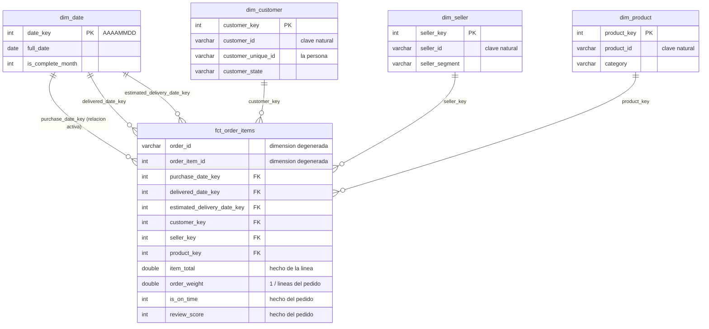

# Modelo estrella: la capa de BI

El análisis de este repositorio responde preguntas puntuales con consultas SQL sueltas.
Un dashboard necesita otra cosa: **un modelo de datos estable**, donde cada número se
calcule de una sola manera sin importar quién arme el gráfico ni en qué herramienta.
Este documento describe ese modelo y justifica cada decisión de diseño.

- El SQL está en [`sql/star/`](../sql/star/), un archivo por tabla, cada uno con sus
  decisiones comentadas en el encabezado.
- `python -m src.star` lo construye sobre las vistas `stg_*`, lo testea y lo exporta a
  `data/bi/`. Si un solo test falla, no se exporta nada.
- Las medidas están en [`medidas.md`](medidas.md) y el diseño del dashboard en
  [`dashboard.md`](dashboard.md).

---

## El modelo



| Tabla | Grano (qué es una fila) | Filas |
|---|---|---:|
| `fct_order_items` | una línea de pedido: `(order_id, order_item_id)` | 112.650 |
| `dim_date` | un día calendario | 1.096 |
| `dim_customer` | un `customer_id` de Olist: el cliente tal como era en un pedido | 99.441 |
| `dim_seller` | un vendedor | 3.095 |
| `dim_product` | un producto | 32.951 |
| `order_items_flat` (vista) | la estrella aplanada: una línea de pedido con todos sus atributos | 112.650 |

Vocabulario usado abajo: el **grano** es lo que representa una fila. Una **clave
sustituta** es un entero generado en el modelo que reemplaza a la clave del sistema de
origen (la **clave natural**). Una **dimensión degenerada** es un identificador que vive
en la tabla de hechos porque no tiene atributos propios que justifiquen una tabla.

---

## Decisiones de diseño

Cada una indica qué se decidió, por qué, qué alternativa se descartó y qué cuesta.

### 1. El grano es la línea de pedido, no el pedido

**Decisión.** Una fila por ítem vendido. La tabla de hechos tiene exactamente las
112.650 filas de `order_items`, y un test lo exige.

**Por qué.** Producto y vendedor son atributos de la línea, no del pedido: 3.236 pedidos
(3,3%) mezclan productos distintos y 1.278 (1,3%) mezclan vendedores. La línea es el
grano atómico: siempre se puede agregar hacia el pedido, nunca al revés.

**Alternativa descartada.** Una fila por pedido. Obliga a elegir un producto y un
vendedor "principal" (y las ventas por categoría o por vendedor quedan mal para esos
pedidos) o a agregar tablas puente.

**Costo.** La entrega y la reseña son hechos del pedido y ahora se repiten en cada una
de sus líneas. Es el tema de la decisión siguiente.

### 2. Los hechos del pedido viven en la tabla de líneas, con dos resguardos

**Decisión.** Fecha de entrega, atraso y calificación se copian a todas las líneas del
pedido. Nunca se suman ni se promedian directamente.

**Por qué importa.** Promediar la calificación sobre las líneas da **4,03**; por pedido
da **4,10**. La diferencia no es ruido: los pedidos de varias líneas pesan de más y
califican peor (3,60 contra 4,16 de los de una sola línea).

**Los dos resguardos.**

1. *Conteos y porcentajes* usan pedidos distintos: `COUNT(DISTINCT order_id)`.
2. *Promedios* se calculan por pedido. En DAX, iterando sobre los pedidos. En las
   herramientas que sólo saben sumar (Looker Studio), con `order_weight`: cada línea
   lleva `1 / líneas del pedido`, de modo que cada pedido pesa exactamente 1. Es la
   asignación de hechos de cabecera al nivel de línea que describe Kimball.

Un test verifica que los pesos de cada pedido suman 1 y que las columnas del pedido son
constantes dentro de él.

**Límite conocido de `order_weight`.** Es exacto en cualquier corte que no parta un
pedido (fecha, estado del cliente, estado del pedido). En cortes por vendedor o por
categoría, un pedido compartido reparte su peso entre sus líneas, y como esos pedidos
son justamente los peor calificados, el promedio queda apenas optimista: hasta 0,02
estrellas por segmento de vendedor, hasta 0,06 por categoría y hasta 0,14 para un
vendedor individual. Por eso las medidas DAX usan el cálculo exacto y el peso queda
como recurso de Looker Studio. Detalle en [`medidas.md`](medidas.md).

**Alternativas descartadas.**

- *Dos tablas de hechos* (pedidos y líneas). Es la respuesta de manual cuando hay dos
  granos. Pero el objetivo del dashboard es cruzar la entrega con el vendedor y la
  categoría, y eso obligaría a filtrar una tabla de hechos a través de la otra
  (relación muchos a muchos por `order_id`, o filtro bidireccional): más frágil y más
  difícil de explicar que una medida bien escrita. Y Looker Studio terminaría igual en
  una tabla plana a nivel línea.
- *El pedido como dimensión.* Sería una dimensión que crece al ritmo de los hechos y
  que guarda métricas: las dos cosas que una dimensión no debe hacer.

**Costo.** La disciplina queda en las medidas. Se mitiga ocultando las columnas crudas
en la herramienta y exponiendo sólo las medidas de `medidas.md`.

### 3. "A tiempo" se decide por día calendario

**Decisión.** Un pedido llega a tiempo si se entrega el día prometido o antes. Se
comparan fechas, no fecha y hora.

**Por qué.** La promesa es un día, no un momento: la fecha prometida no trae hora (está
guardada siempre a las 00:00:00). Si la promesa dijera una hora, entregar después de
esa hora sería llegar tarde; como sólo dice el día, entregar cualquier hora de ese día
es cumplir. Comparando fecha y hora, un paquete entregado a las 15:00 del día prometido
contaría como tardío. Hay 1.292 pedidos en esa situación, y sus clientes los califican
como entregas a tiempo: 4,03 estrellas, contra 2,99 de los que llegan de 1 a 5 días
tarde.

**Qué cambia.** Con esta regla el 6,8% de las entregas es tardío; comparando fecha y
hora sería el 8,1%.

**Una sola definición en todo el repositorio.** La regla vive en un único lugar, la
columna `is_late` de `stg_orders` (`sql/00_staging.sql`), y de ahí la toman tanto las
consultas del análisis como este modelo. Dos controles la sostienen:

- un test verifica que ninguna fecha prometida trae hora; si un refresco de datos la
  trajera, la regla habría que revisarla y el pipeline lo avisa;
- las reconciliaciones con las consultas `01` (calificación por banda de atraso) y `02`
  (atraso por categoría) comprueban que el modelo y el análisis cuentan los mismos
  pedidos tardíos.

Las cifras por estado del dashboard pueden diferir en décimas de las del README
(Maranhão 17,5% contra 17,3%) sólo porque el dashboard filtra por defecto los meses
completos.

### 4. Claves sustitutas enteras en las dimensiones

**Decisión.** `customer_key`, `seller_key` y `product_key` son enteros generados. Las
claves de Olist (hashes de 32 caracteres) quedan como atributo en cada dimensión.

**Por qué.**

- *Tamaño y velocidad.* Los motores columnares de BI comprimen mal el texto de alta
  cardinalidad. Medido en este dataset: la tabla de hechos pesa 7,4 MB en Parquet con
  claves enteras y 11,3 MB con los hashes (34% menos).
- *Independencia del origen.* Si mañana cambia la clave del sistema de origen, o una
  dimensión necesita guardar historia, la tabla de hechos no se toca.
- *Trazabilidad intacta.* La clave natural sigue en la dimensión para volver al dato
  original.

**Excepción.** `order_id` queda como texto en la tabla de hechos: es una dimensión
degenerada, no tiene tabla a la cual mover el hash, y hace falta para contar pedidos.

**Sin fila "desconocido".** La integridad referencial del origen es total (0 líneas sin
producto, vendedor o cliente) y un test la exige. Si un día aparece un huérfano, el
test falla; un `-1` lo escondería.

### 5. Una tabla de fechas propia, que cumple tres roles

**Decisión.** `dim_date` tiene una fila por día, sin huecos, de 2016-01-01 a
2018-12-31. La tabla de hechos apunta a ella tres veces: fecha de compra, de entrega y
de entrega prometida (*role-playing dimension*).

**Por qué.**

- Las funciones de inteligencia de tiempo de Power BI (mes anterior, acumulado del año)
  necesitan una tabla de fechas contiguas marcada como tal. La alternativa automática
  crea una tabla oculta por cada columna de fecha.
- Una sola tabla de fechas hace que "marzo de 2018" sea la misma fila se mire por la
  fecha que se mire. En Power BI la relación activa es la de compra; las otras dos se
  activan dentro de una medida con `USERELATIONSHIP`.
- Años completos, porque las funciones de acumulado anual lo requieren.

**La clave es `AAAAMMDD` (20180131).** Es la única dimensión donde una clave "con
significado" es la convención aceptada: se lee en la tabla de hechos y ordena
cronológicamente. `full_date` lleva el tipo fecha real.

**Sin fila "fecha desconocida".** Los pedidos nunca entregados tienen
`delivered_date_key` nulo. Una fila ficticia (1900-01-01) rompería la contigüidad que
exige una tabla de fechas marcada.

**`is_complete_month`.** Los primeros meses son un piloto (septiembre de 2016: 4
pedidos; octubre: 324; diciembre: 1) y los dos últimos están truncados (16 y 4
pedidos). Graficarlos dibuja un lanzamiento y un derrumbe que no existieron. La
bandera vale 1 de 2017-01 a 2018-08 y es el filtro por defecto del dashboard. Es la
misma regla que `is_partial_month` en `sql/05_revenue_seasonality.sql`.

### 6. El cliente: `customer_id` no es una persona

**Decisión.** `dim_customer` tiene una fila por `customer_id` (99.441). La persona es
`customer_unique_id` (96.096) y queda como atributo.

**Por qué.** Olist genera un `customer_id` nuevo en cada pedido: es una foto del
comprador en el momento de la compra, dirección de entrega incluida. Funciona como una
dimensión de cambio lento de tipo 2 que el origen ya versionó. Conservar ese grano
mantiene cada pedido en el estado al que realmente se envió: 250 personas compraron
desde más de un prefijo postal y 39 desde más de un estado.

**Alternativa descartada.** Una fila por persona con su última dirección (tipo 1). Más
intuitiva, pero reporta en el estado equivocado los pedidos de quien se mudó, y
"entregas tardías por estado" es justo el gráfico para el que existe este modelo.

**Consecuencia práctica.** Los clientes se cuentan con
`DISTINCTCOUNT(customer_unique_id)`, nunca contando filas ni `customer_id`.

**Una dimensión casi tan grande como los hechos** no es un defecto del modelo, es un
rasgo del negocio: el 97% de los clientes compra una sola vez.

### 7. El vendedor: el segmento es un atributo, no un cálculo en vivo

**Decisión.** `seller_segment` (Núcleo, En ascenso, Estable, En riesgo) se calcula una
vez con las reglas de `sql/04_seller_segmentation.sql` y se guarda en la dimensión,
junto a los datos que lo explican (`lifetime_orders`, `lifetime_gmv`,
`lifetime_pct_shipped_late`, `lifetime_avg_review_score`).

**Por qué.** Como atributo, cualquier medida se puede cortar por segmento y la etiqueta
es estable. Calculado en vivo, un vendedor cambiaría de segmento cada vez que alguien
mueve el filtro de fechas.

**Costo.** Es una foto de toda la historia. Las columnas `lifetime_*` no reaccionan a
los filtros, y el prefijo lo avisa. Lo que deba seguir un filtro se calcula con una
medida sobre la tabla de hechos.

**`seller_code`** (`V0001`) es una etiqueta corta para mostrar: los vendedores son
anónimos y un hash de 32 caracteres es ilegible en una tabla.

### 8. El producto: una dimensión angosta porque el dato es angosto

**Decisión.** `dim_product` lleva la categoría, una etiqueta presentable
(`category_label`: `bed_bath_table` → `Bed bath table`) y tres atributos físicos.

**Por qué.** Los productos de Olist son anónimos: sin nombre, sin marca. La categoría
es el único atributo por el que un usuario de negocio filtraría. No se inventó una
jerarquía de "departamentos" encima: sería un atributo que el dato no trae.

**Una sola definición de categoría.** Se aplica la regla de `stg_order_items`
(traducción al inglés; si falta, el nombre en portugués; si falta, `unknown`), y un
test verifica que cada línea llega a la misma categoría por la dimensión que en
staging.

### 9. Geografía dentro de cada dimensión, no en una tabla aparte

**Decisión.** Nombre del estado, código ISO (`BR-SP`) y región se copian dentro de
`dim_customer` y `dim_seller`.

**Por qué.** Una tabla de geografía compartida por dos dimensiones convierte la
estrella en un copo de nieve: un salto más para el usuario y nada ganado con 27 filas.
El código ISO existe porque los mapas lo geocodifican sin ambigüedad.

### 10. Las definiciones de negocio se fijan en SQL, no en la herramienta

**Decisión.** Qué es "entregado", "a tiempo", "tarde" o "cancelado" se resuelve en SQL
y llega a la herramienta como bandera 0/1 (`is_delivered`, `is_on_time`, `is_late`,
`is_canceled`). "Entregado" y "tarde" vienen de staging (`sql/00_staging.sql`), donde
también los usa el análisis; `sql/star/05_fct_order_items.sql` los pasa a la tabla de
hechos y agrega "cancelado".

**Por qué.** Una definición escrita una vez no puede diferir entre Power BI y Looker
Studio, ni entre el dashboard y el README. Las medidas de cada herramienta quedan en
una o dos líneas: sólo agregan.

**Por qué enteros y no booleanos.** Se comportan igual en DAX, en Looker Studio y en un
CSV, y se pueden multiplicar por `order_weight`.

### 11. Ventas = precio + flete, y los cancelados se marcan en vez de borrarse

**Decisión.** `item_total = price + freight_value`. Las medidas de ventas excluyen los
pedidos `canceled` y `unavailable` usando `is_canceled`; las filas siguen en la tabla.

**Por qué.** Precio más flete es lo que pagó el cliente y es la definición de ingresos
de `sql/05_revenue_seasonality.sql`, así el dashboard reproduce el ticket promedio de
R$ 160 del README. El precio solo (`price`) también está disponible: son R$ 13,5
millones de mercadería sobre R$ 15,7 millones de ventas. Marcar en lugar de borrar
mantiene la conciliación con el origen al centavo y deja calcular una tasa de
cancelación.

### 12. Lo que queda fuera del modelo

- **775 pedidos sin ítems** (603 `unavailable`, 164 `canceled`, 8 en otros estados). Sin
  línea no hay fila: no tienen producto, vendedor ni importe. Sus reseñas (756,
  promedio 1,72) quedan afuera, por eso la calificación promedio del modelo es 4,10 y
  la de todos los pedidos es 4,09.
- **Pagos.** Un pedido puede tener varios pagos (medio, cuotas). Es otro grano, así que
  sería otra tabla de hechos, no columnas en esta.
- **Distancia vendedor–cliente y texto de las reseñas.** Se quedan en el análisis.

### 13. Staging en vistas, estrella en tablas

**Decisión.** Las `stg_*` son vistas; `dim_*` y `fct_*` son tablas.

**Por qué.** La limpieza conviene que esté siempre al día y no ocupa nada. La estrella
es lo que lee la herramienta de BI: se materializa para que las claves sustitutas sean
estables y para poder testear exactamente lo mismo que se exporta.

### 14. Un modelo, dos formas de entrega

**Decisión.** Power BI recibe las cinco tablas en Parquet. Looker Studio recibe una
sola tabla ancha en CSV (`order_items_flat`).

**Por qué.** Looker Studio no tiene modelo de datos: combina fuentes con un tope de
cinco tablas, vuelve a unirlas en cada gráfico y no puede expresar una fecha con tres
roles. Parquet para Power BI porque conserva los tipos: con CSV, una PC con coma
decimal puede leer `129.90` como 12.990, y un prefijo postal `01151` pierde el cero.

**Garantía.** La tabla plana es una vista sobre la estrella, sin lógica propia, y un
test verifica que tiene las mismas filas y el mismo total. Los dos dashboards no pueden
divergir.

### 15. Identificadores en inglés, etiquetas visibles en español

**Decisión.** Tablas y columnas en inglés, como el resto del SQL del repositorio. Los
valores que se ven en un gráfico (meses, días, bandas de entrega, segmentos, regiones)
en español.

**Por qué.** Los nombres físicos siguen la convención del código; lo que lee quien mira
el dashboard está en su idioma. Las categorías quedan en inglés porque es la traducción
oficial que trae el dataset.

---

## Tests

`python -m src.star` corre dos grupos de pruebas antes de exportar.

**35 tests de datos** ([`sql/star/99_tests.sql`](../sql/star/99_tests.sql)):

| Grupo | Qué garantiza |
|---|---|
| Claves y grano | cada tabla tiene el grano que declara; `dim_date` no tiene huecos |
| Integridad referencial | toda línea encuentra su cliente, vendedor, producto y fechas |
| Conciliación | filas, precio y flete coinciden con el origen al centavo |
| Hechos del pedido | los pesos suman 1 por pedido; las banderas son coherentes entre sí |
| Tabla plana | mismas filas y mismo total que la tabla de hechos |
| Regla de atraso | la fecha prometida nunca trae hora (el supuesto de la decisión 3) |

El más importante es el de filas: una clave duplicada en una dimensión multiplica las
ventas en silencio, y ningún gráfico lo delata.

**5 reconciliaciones con el análisis** (`reconcile` en [`src/star.py`](../src/star.py)):
el modelo tiene que reproducir los resultados de las consultas `01` (calificación por
banda de atraso), `02` (pedidos y porcentaje de atraso por categoría), `03` (tasa de
recompra), `04` (vendedores y ventas por segmento) y `05` (ventas y pedidos mes a mes). El dashboard y el README no pueden contradecirse sin
que el pipeline falle.

---

## Diccionario de datos

### `fct_order_items`

| Columna | Tipo | Descripción |
|---|---|---|
| `order_id` | texto | Pedido. Dimensión degenerada; se usa para contar pedidos. |
| `order_item_id` | entero | Número de línea dentro del pedido. |
| `purchase_date_key` | entero | Fecha de compra → `dim_date`. Relación activa. |
| `delivered_date_key` | entero | Fecha de entrega al cliente → `dim_date`. Nulo si no hay fecha de entrega. |
| `estimated_delivery_date_key` | entero | Fecha de entrega prometida → `dim_date`. |
| `customer_key` | entero | → `dim_customer`. |
| `seller_key` | entero | → `dim_seller`. |
| `product_key` | entero | → `dim_product`. |
| `order_status` | texto | Estado del pedido en el origen (`delivered`, `shipped`, `canceled`…). |
| `delivery_bucket` | texto | Banda de cumplimiento: `10+ días antes` … `11+ días tarde`, `No entregado`. |
| `delivery_bucket_sort` | entero | Orden de la banda (1 a 7). |
| `price` | decimal | Precio del ítem. **Hecho de la línea: se puede sumar.** |
| `freight_value` | decimal | Flete del ítem. Se puede sumar. |
| `item_total` | decimal | `price + freight_value`. Se puede sumar. |
| `order_weight` | decimal | `1 / líneas del pedido`. Suma 1 por pedido. |
| `is_canceled` | 0/1 | Estado `canceled` o `unavailable`. |
| `is_delivered` | 0/1 | Entregado, con fecha de entrega válida. |
| `is_on_time` | 0/1 | Entregado el día prometido o antes. |
| `is_late` | 0/1 | Entregado después del día prometido. |
| `days_to_deliver` | entero | Días de la compra a la entrega. Nulo si no fue entregado. |
| `days_vs_estimate` | entero | Días respecto de la fecha prometida; negativo = llegó antes. |
| `days_late` | entero | Días de atraso. Nulo salvo en pedidos tardíos. |
| `review_score` | entero | Calificación del pedido, 1 a 5. Nulo si no hay reseña. |
| `is_shipped_late` | 0/1 | El vendedor despachó después de su fecha límite. Nulo sin fecha de despacho. |

De `is_canceled` hacia abajo son **hechos del pedido**, repetidos en cada línea: ver la
decisión 2 antes de agregarlos.

### `dim_date`

| Columna | Tipo | Descripción |
|---|---|---|
| `date_key` | entero | Clave, `AAAAMMDD`. |
| `full_date` | fecha | El día. Columna para marcar la tabla de fechas. |
| `year`, `quarter`, `month` | entero | Año, trimestre (1–4), mes (1–12). |
| `year_quarter` | texto | `2018-T1`. |
| `month_name` | texto | `enero` … `diciembre`. Ordenar por `month`. |
| `month_start` | fecha | Primer día del mes; eje continuo para series mensuales. |
| `year_month` | texto | `ene 2018`. Ordenar por `year_month_sort`. |
| `year_month_sort` | entero | `201801`. |
| `iso_week` | entero | Semana ISO. |
| `day_of_month` | entero | Día del mes. |
| `day_of_week` | entero | 1 = lunes … 7 = domingo. |
| `day_name` | texto | `lunes` … `domingo`. Ordenar por `day_of_week`. |
| `is_weekend` | 0/1 | Sábado o domingo. |
| `is_complete_month` | 0/1 | Mes con datos completos (2017-01 a 2018-08). |

### `dim_customer`

| Columna | Tipo | Descripción |
|---|---|---|
| `customer_key` | entero | Clave sustituta. |
| `customer_id` | texto | Clave natural: un valor por pedido. |
| `customer_unique_id` | texto | La persona. Es lo que se cuenta como "clientes". |
| `customer_city` | texto | Ciudad de entrega, tal como viene del origen. |
| `customer_state` | texto | Sigla del estado (`SP`). |
| `customer_state_name` | texto | Nombre del estado (`São Paulo`). |
| `customer_state_iso` | texto | Código ISO 3166-2 (`BR-SP`), para mapas. |
| `customer_region` | texto | Norte, Nordeste, Centro-Oeste, Sudeste o Sul. |
| `customer_zip_prefix` | texto | Prefijo postal. |
| `customer_lifetime_orders` | entero | Pedidos no cancelados de la persona, en toda la historia. |
| `is_repeat_customer` | 0/1 | La persona tiene 2 o más pedidos. |

### `dim_seller`

| Columna | Tipo | Descripción |
|---|---|---|
| `seller_key` | entero | Clave sustituta. |
| `seller_id` | texto | Clave natural. |
| `seller_code` | texto | Etiqueta corta para mostrar (`V0001`). |
| `seller_city`, `seller_state`, `seller_state_name`, `seller_state_iso`, `seller_region`, `seller_zip_prefix` | texto | Ubicación, igual que en el cliente. |
| `seller_segment` | texto | Núcleo, En ascenso, Estable o En riesgo. |
| `seller_segment_sort` | entero | Orden del segmento (1 a 4). |
| `lifetime_orders` | entero | Pedidos del vendedor en toda la historia. |
| `lifetime_gmv` | decimal | Suma de precios, sin flete. |
| `lifetime_pct_shipped_late` | decimal | Fracción de pedidos despachados fuera de plazo. |
| `lifetime_avg_review_score` | decimal | Calificación promedio de sus pedidos. |

### `dim_product`

| Columna | Tipo | Descripción |
|---|---|---|
| `product_key` | entero | Clave sustituta. |
| `product_id` | texto | Clave natural. |
| `category` | texto | Categoría en inglés (`bed_bath_table`); `unknown` si no tiene. |
| `category_label` | texto | La misma, presentable (`Bed bath table`). |
| `category_pt` | texto | Nombre original en portugués. |
| `product_weight_g`, `product_volume_cm3`, `product_photos_qty` | entero | Peso, volumen y cantidad de fotos. |

### `order_items_flat`

Las columnas de la tabla de hechos más los atributos de las dimensiones que usa un
dashboard, con los mismos nombres. Las tres fechas llegan como `purchase_date`,
`delivered_date` y `estimated_delivery_date`. No trae `customer_id`, `seller_id` ni
`product_id`.

---

## Cómo reconstruirlo

```powershell
python -m src.star        # construye la estrella, corre los tests y exporta
```

También es el paso 5 de `python run_all.py`. Los archivos quedan en `data/bi/`, que
está en el `.gitignore` como el resto de `data/`:

```
data/bi/power_bi/         dim_date, dim_customer, dim_seller, dim_product, fct_order_items  (.parquet)
data/bi/looker_studio/    order_items_flat.csv
data/bi/csv/              las cinco tablas en CSV, para cualquier otra herramienta
```
